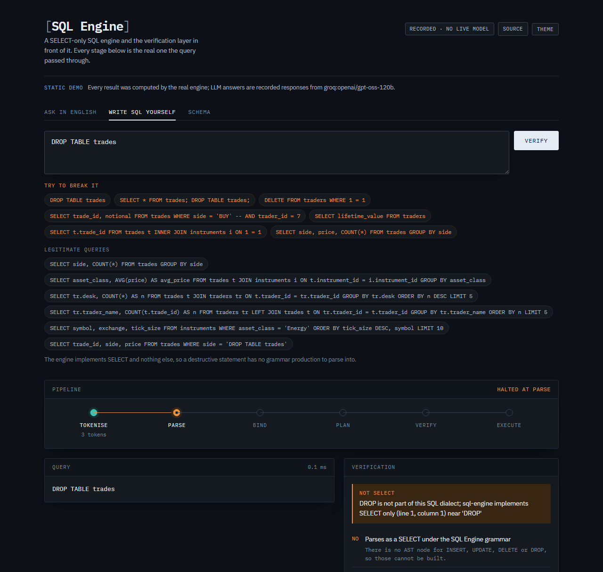
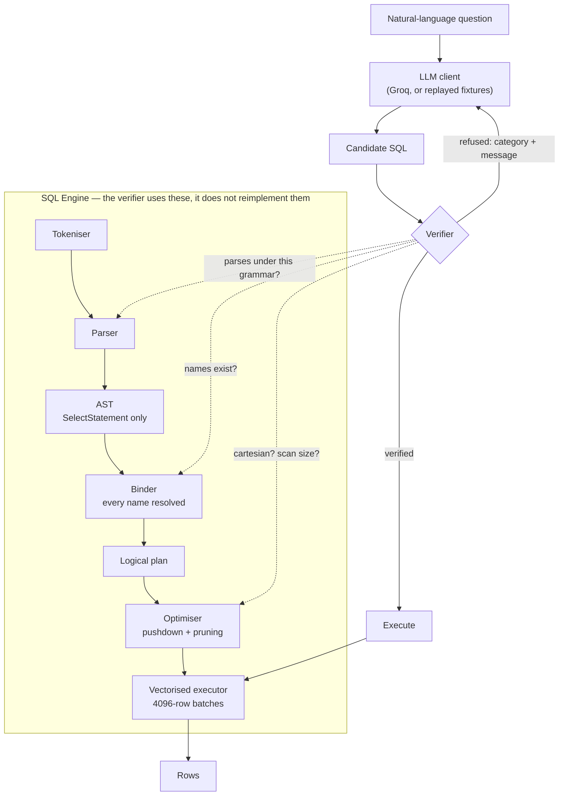
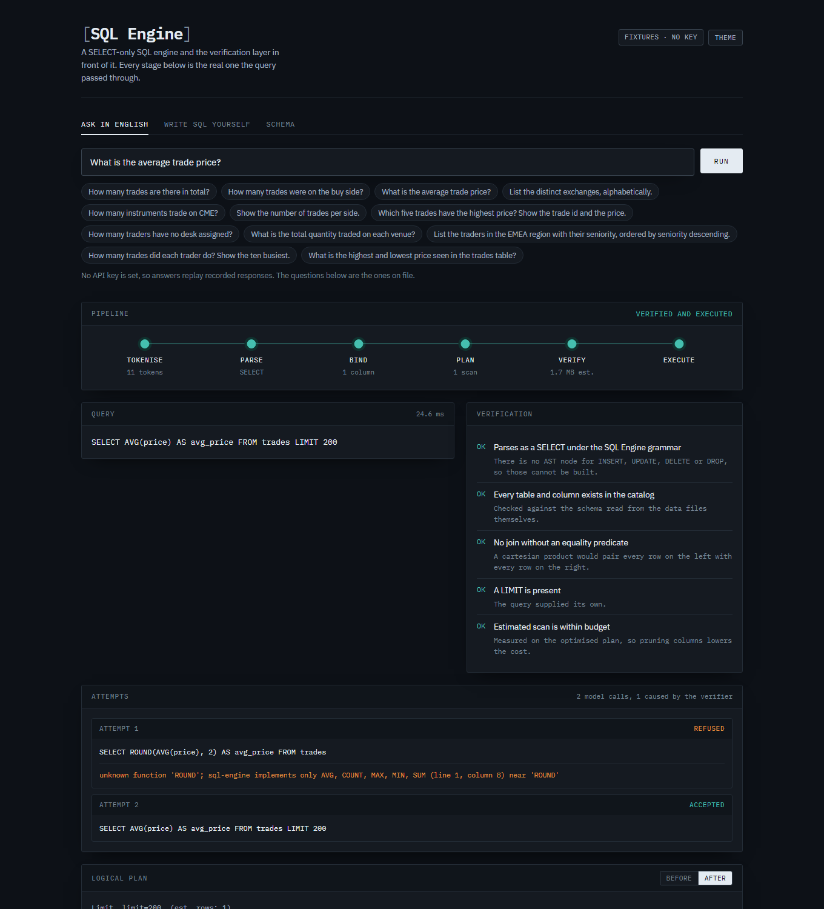
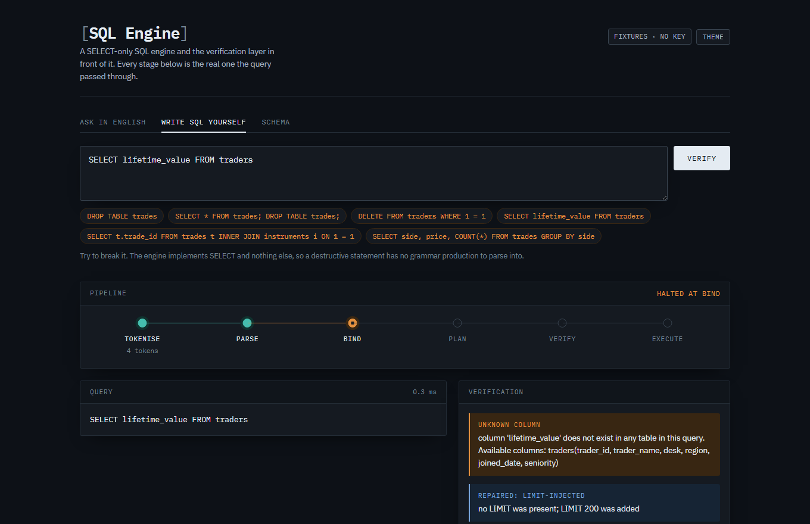
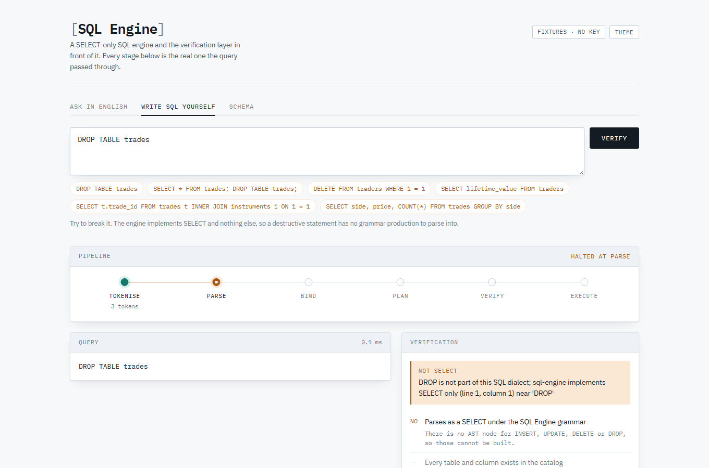

# SQL Engine

**Demo: [`web/`](web/index.html)** — a static build of the web
UI. Every result on the page was computed by the real engine; the LLM answers are recorded
responses from `groq:openai/gpt-oss-120b`.

[](web/index.html)

A SQL query engine written from scratch in Python, and a natural-language front-end that
cannot use it to do damage.

The engine implements `SELECT`. Not "implements SQL and rejects the dangerous parts" —
implements `SELECT`, and nothing else. There is no AST node for `INSERT`, no parser
production for `DROP`, and no code path anywhere in the package that opens a data file
for writing.

That is the argument the whole project exists to make:

> **The LLM cannot write a destructive query against this engine, because this engine
> cannot execute one.**

A blocklist can be bypassed. A regex can be evaded. A missing grammar production cannot
be talked around.

---

## What is here

```
sql_engine/
  tokeniser.py     hand-written lexer, tracks line/column for error messages
  ast_nodes.py     the AST -- read it to see what cannot be expressed
  parser.py        recursive descent, precedence climbing; full grammar in the docstring
  catalog.py       table -> file + schema + statistics, inferred from the files themselves
  binder.py        name resolution; every column is proven to exist here
  plan.py          logical plan nodes with cardinality estimates
  planner.py       bound statement -> logical plan
  optimiser.py     predicate pushdown, projection pruning
  estimation.py    System-R style selectivity model (crude, and labelled as such)
  executor/        vectorised, batch-at-a-time operators over NumPy arrays
  llm/             verifier, prompt construction, bounded repair loop, LLM clients
  web/             FastAPI app and the single-page UI
  sqlite_oracle.py the differential-testing harness
```

## Architecture



The verifier does not use `sqlparse`, `sqlglot`, or a regex. It uses **this engine's own
parser and catalog**. There is therefore no gap between what the verifier accepts and
what the engine runs — and that gap is where every SQL-injection bug in history lives.

## The five checks

| # | Check | Enforced by |
| --- | --- | --- |
| 1 | It parses under the sql-engine grammar, so it is a `SELECT` by construction | the grammar itself |
| 2 | Every table and column exists in the catalog | the binder |
| 3 | No join without an equality predicate (no cartesian product) | the logical plan |
| 4 | A `LIMIT` is present, or one is injected | AST rewrite, reported as a repair |
| 5 | The estimated scan is within a byte budget | the optimised plan |

Check 1 is not really a check. It is a statement about what the parser can build.

---

## Quick start

```bash
python -m pip install -e ".[dev]"
python data/generate.py          # writes the demo warehouse (~8 MB)
python -m pytest                 # the whole suite, no API key needed
python -m sql_engine.cli serve   # then open http://127.0.0.1:8000
```

Command line:

```bash
python -m sql_engine.cli query   "SELECT side, COUNT(*) FROM trades GROUP BY side"
python -m sql_engine.cli explain "SELECT trade_id FROM trades WHERE trader_id = 7"
python -m sql_engine.cli verify  "DROP TABLE trades"
```

```
$ python -m sql_engine.cli verify "DROP TABLE trades"
REFUSED
  [not_select] DROP is not part of this SQL dialect; sql-engine implements SELECT only
  (line 1, column 1) near 'DROP'
```

## The web UI

Ask a question in English. You see the SQL, every attempt including the refused ones,
the verdict with its reasons, both query plans, and the rows. Nothing is hidden behind
a spinner.

The rail across the middle is the six compilation stages. It stops at the stage that
refused the query and says so.

**A verified answer, after one repair:**



**A refusal — an invented column, and the rail halts at BIND:**



**Light theme; `DROP TABLE trades` halts at PARSE. The checks below the halt say "not
reached" rather than claiming to have passed:**



The "Write SQL yourself" tab exists so you can try to break it rather than take my word
for it.

**The demo in `web/` is this page, built static.** GitHub Pages cannot run Python, so
`python scripts/export_static_demo.py` drives the real app in-process and saves the exact
JSON its API returns — for the 45 golden-set questions (model answers replayed from
`evaluation/fixtures/recorded.json`) and a curated set of SQL, refusals first — into
`web/data/`. The page in [`web/`](web/) only looks those results up: it calls no model and
holds no key, and anything outside that set gets a message saying how to run it locally.
Each recorded answer also shows how it scored against the hand-written gold query, because
a verified query can still be the wrong query.

---

## What the optimiser does

`EXPLAIN` prints the plan before and after optimisation, with estimated row counts, so
the rewrite is visible rather than asserted.

```
$ python -m sql_engine.cli explain "SELECT trade_id FROM trades WHERE trader_id = 7 LIMIT 5"

Logical plan (before optimisation)
  Limit  limit=5  (est. rows: 5)
    Project  trades.trade_id  (est. rows: 5,000)
      Filter  (trades.trader_id = 7)  (est. rows: 5,000)
        Scan[parquet] trades  columns=ALL(9)  (est. rows: 200,000)

Logical plan (after optimisation)
  Limit  limit=5  (est. rows: 5)
    Project  trades.trade_id  (est. rows: 5,000)
      Scan[parquet] trades  columns=[trade_id, trader_id]  pushed=(trades.trader_id = 7)  (est. rows: 5,000)

Optimiser
  predicate pushdown: 1 conjunct(s) pushed into scans; projection pruning: 2/9 columns read (7 pruned)
```

Two rules, both classical:

- **Predicate pushdown** moves `WHERE` conjuncts down the tree and into the scan, where
  they are applied to each batch before anything else sees it. Conjuncts are split, so
  `a.x = 1 AND b.y = 2` reaches two different scans. A predicate is never pushed through
  `LIMIT`, and the outer-join asymmetry is respected: a `WHERE` predicate on the
  null-supplying side of a `LEFT JOIN` may not be pushed, while an `ON` predicate on that
  same side may be. Both directions are tested.
- **Projection pruning** hands the Parquet reader only the columns the query actually
  needs, so pruned columns are never decoded.

---

## Correctness

Every claim below rests on one procedure: **run the same query in sql-engine and in SQLite
over the same data and compare the results.** SQLite is the specification; if the two
disagree, sql-engine is wrong.

- **108 hand-written differential queries** covering NULL semantics, three-valued logic,
  integer division sign rules, joins, aggregation, ordering, `DISTINCT`, and paging.
- **Property-based differential tests** (Hypothesis) that assemble random `WHERE` clauses
  from comparisons, `IN`, `BETWEEN`, `IS NULL`, `AND`, `OR` and `NOT`, then check both
  engines agree. Three-valued logic is where hand-written tests run out of imagination.
- **The optimiser is run twice over the whole corpus**, with the rules on and off, and
  the results must be identical. A separate test asserts the rules actually fire, so
  that comparison cannot pass vacuously.
- **Batch-size independence**: the same queries at batch sizes 1, 3, 7, 64, 4096 and
  65536 must return byte-identical results. Off-by-one bugs at chunk boundaries are the
  characteristic failure of a batched executor.

```
$ python -m pytest
483 passed in 53.76s
```

(472 on a clone without the optional Spider dev files, where six tests skip.)

The comparison itself is careful about what counts as a difference. Row order is only
compared when the query has an `ORDER BY`; floats are compared with a tolerance, because
NumPy's pairwise summation and SQLite's sequential summation genuinely disagree in the
14th significant digit over 200,000 values (see `FAILURES.md` #5).

---

## Benchmarks

Full detail and methodology in [`bench/results.md`](bench/results.md), regenerated by
`python bench/run_bench.py`. Median of 7 runs after a discarded warm-up, on CPython
3.11.9 / Windows 10 / AMD64, over 200,000 trades in Parquet.

**sql-engine against itself, with the optimiser on and off** — the number this project
owns, because it is the same code path either way:

| query | speedup | columns read | conjuncts pushed | rows kept at scan |
| --- | ---: | ---: | ---: | ---: |
| `count_filtered` | **8.17x** | 9 → 1 | 1 | 4,956 / 200,000 |
| `join_filter` | **3.97x** | 16 → 6 | 2 | 50,227 / 200,120 |
| `filter_project` | **3.59x** | 9 → 2 | 1 | 1,163 / 45,056 |
| `sort_limit` | **3.46x** | 9 → 3 | 0 | 200,000 / 200,000 |
| `group_by_wide` | **2.56x** | 9 → 3 | 0 | 200,000 / 200,000 |
| `join_group` | **2.36x** | 16 → 4 | 0 | 200,120 / 200,120 |
| `selective_scan` | **2.21x** | 9 → 4 | 3 | 1,182 / 200,000 |
| `group_by_small` | **1.94x** | 9 → 3 | 0 | 200,000 / 200,000 |
| `distinct` | **1.70x** | 9 → 2 | 0 | 200,000 / 200,000 |

**Against SQLite and pandas** — ratio of median wall-clock time; above 1.0 means
sql-engine is slower:

| query | sql-engine (s) | vs SQLite (file) | vs SQLite (memory) | vs pandas |
| --- | ---: | ---: | ---: | ---: |
| `filter_project` | 0.0078 | 1.61x | 2.44x | 0.99x |
| `count_filtered` | 0.0116 | 0.66x | 1.10x | 3.66x |
| `group_by_small` | 0.0715 | 0.69x | 0.76x | 2.06x |
| `group_by_wide` | 0.0581 | 0.51x | 0.58x | 3.61x |
| `selective_scan` | 0.0628 | 3.01x | 5.12x | 2.35x |
| `join_group` | 0.0975 | 0.59x | 0.70x | 2.58x |
| `join_filter` | 0.0627 | 0.71x | 1.07x | 3.14x |
| `sort_limit` | 0.0550 | 2.02x | 2.86x | 0.57x |
| `distinct` | 0.0940 | 0.70x | 0.73x | 3.20x |

**Read that table honestly.** sql-engine and pandas read Parquet from disk on every run;
SQLite runs against a database that was already loaded (1.55 s in memory, 2.31 s to file,
both excluded from its timings). sql-engine is pure Python over NumPy and SQLite is thirty
years of C. Where sql-engine comes out ahead — the group-bys and joins — it is because a
vectorised aggregate over a columnar batch is genuinely a good fit for NumPy, and because
the scan reads three columns where SQLite's row store reads whole rows. Where it loses —
`selective_scan`, `sort_limit` — it loses because SQLite has real indexes and sql-engine
has none.

---

## Evaluation of the LLM layer

Full report in [`evaluation/results.md`](evaluation/results.md), regenerated by
`python evaluation/run_eval.py --fixtures recorded`.

### Read this before quoting any number below

**These are real responses from a live model** — `groq:openai/gpt-oss-120b`, recorded on
2026-09-09 by `evaluation/record_fixtures.py` and committed to
`evaluation/fixtures/recorded.json`. Re-record with `GROQ_API_KEY` set and every number
below regenerates.

One caveat remains: **the question set is hand-built.** 45 question/SQL pairs over the
demo warehouse, in `evaluation/golden_set.jsonl`. Every gold query is validated to run in
*both* engines and return identical rows. **No Spider accuracy number is claimed anywhere
in this repository** — Spider execution accuracy needs the 20 dev SQLite databases, which
are not here, and an engine that can run Spider's gold queries, which this deliberately
cannot. A different, honest Spider measurement *is* reported: see
[Spider coverage](#spider-coverage).

### Execution accuracy

Measured as the literature measures it: run the gold query and the predicted query,
compare the result sets. The gold side runs through **SQLite**, not through sql-engine, so
an engine bug affecting both sides identically cannot hide.

| Regime | Correct | Accuracy |
| --- | ---: | ---: |
| First answer executed directly, no verification | 19 / 45 | 42.2% |
| Verified, with the repair loop | 19 / 45 | 42.2% |
| **Difference** | **+0** | **+0.0 points** |

### The verifier added nothing here, and that is the finding

An earlier version of this table showed +26.7 points. That number came from
hand-authored fixtures written before an API key was available — fixtures which, being
written to exercise the verifier, contained exactly the errors the verifier catches. It
was circular, and it is gone.

Against a real model the honest answer is **zero lift**, because
`openai/gpt-oss-120b` does not make the errors this layer detects. Across all 45
questions it never invented a column, never emitted a non-`SELECT`, never wrote a
cartesian join. Every answer passed verification; 26 of them were still wrong.

That is worth stating plainly rather than burying:

- **Structural verification cannot catch a semantic error.** A query can reference only
  real columns, bind cleanly, pass every safety check, and still answer a different
  question than the one asked. 26 of 45 did exactly that.
- **The layer's value is on the tail, not the mean.** Well-formed model output is not
  where a safety layer earns its place. Deliberately hostile or broken input is — and
  that is measured separately, on 48 labelled adversarial cases, in
  [`evaluation/adversarial_results.md`](evaluation/adversarial_results.md):
  **44/48 correct verdicts, 90.5% of malicious or broken SQL refused, and all 6
  legitimate queries preserved.**

The two measurements answer different questions. `run_eval.py` measures the *model*;
`run_adversarial.py` measures the *verifier*. Reporting only the first would have made
the verifier look pointless; reporting only the second would have made it look like an
accuracy improvement it is not.

### What the verifier caught on real model output

**Nothing. Zero of 45 first answers were refused**, and the repair loop never fired.

That is not a bug in the verifier — it is what a strong model looks like from the
verifier's side. Every check exists to catch a specific failure, and this model committed
none of them: no invented columns, no non-`SELECT` statements, no cartesian joins, no
aggregation mistakes. The full category breakdown, with all zeroes, is in
`evaluation/results.md`.

The verifier's checks are exercised — and pass — against the adversarial corpus instead.
That is the appropriate place to measure them.

### The verifier's blind spot, stated plainly

**26 of the 45 questions were answered with SQL that parses, binds, passes every safety
check — and returns the wrong rows.** That is the majority of the errors, and none of
them are reachable by structural analysis. Two representative cases:

- The model wrote `WHERE side = 'buy'`; the data stores `'BUY'`. The query is valid and
  returns nothing. A schema gives the model column names and types but **not the value
  domain**, so casing is a guess. Sampling distinct values of low-cardinality columns
  into the prompt is the obvious fix and is listed under Limitations.
- Asked for the ten busiest traders, the model returned `trader_id, trader_name, COUNT(*)`
  where the gold returns `trader_id, COUNT(*)`. Arguably a *better* answer; scored wrong,
  because exact result-set matching is unforgiving about shape.

Both are reported rather than argued away. The second in particular means **42.2% is a
floor, not a verdict on the model** — strict set-equality penalises defensible answers.
Loosening it would have produced a nicer number and a less honest one.

---

## Spider coverage

How small is "a deliberately small subset of SQL"? Rather than answer with adjectives,
`python evaluation/spider_coverage.py` takes the **1,034 gold queries of the real Spider
dev split** (20 databases) and measures how many this dialect can express. Full report in
[`evaluation/spider_coverage.md`](evaluation/spider_coverage.md).

**This is coverage, not accuracy.** It says nothing about whether sql-engine would get
Spider questions *right*; that would need the dev databases and is not claimed.

| Stage | Queries | Share |
| --- | ---: | ---: |
| Gold queries in the dev split | 1,034 | 100.0% |
| Parse under the sql-engine grammar | 875 | 84.6% |
| Also bind against the Spider schema | 588 | 56.9% |
| Also bind, after rewriting Spider's double-quoted string literals | 774 | 74.9% |

Every rejection has exactly one cause, and there is no long tail:

| Reason | Queries | Note |
| --- | ---: | --- |
| subquery | 83 | not implemented |
| set operation (`UNION`/`INTERSECT`/`EXCEPT`) | 76 | not implemented |
| double-quoted string literal | 186 | *not* a missing feature — see below |
| bare column alongside an aggregate | 101 | sql-engine is stricter than SQLite, deliberately |

Two of those rows are worth a sentence each.

**The double-quoted literals are a quoting difference, not a limitation.** Spider's gold
SQL writes `WHERE Airline = "JetBlue Airways"`. In standard SQL, double quotes delimit an
*identifier*, so sql-engine correctly reports that no column of that name exists. SQLite
accepts it through a compatibility fallback its own documentation calls a misfeature.
Counting those as "unsupported" would have understated coverage by 18 points, so both
numbers are reported. This nearly went into the README wrong; see `FAILURES.md` #8.

**The 101 aggregation rejections are a choice with a measured price.** sql-engine refuses
`SELECT name, COUNT(*) ... GROUP BY id`, which SQLite answers by picking an arbitrary row
for `name`. Accepting it would make results non-deterministic on exactly the queries an
LLM most often gets wrong. That choice costs 9.8% of Spider dev, and now that is a number
rather than a hunch.

The parse-failure table is also the ordered to-do list for widening the dialect:
subqueries first, set operations second, and nothing else in Spider dev needs anything
this engine lacks — no comma joins, no scalar functions, no `CASE`, no `||`, no `USING`.

---

## Design notes

**The executor is vectorised.** Operators pass `Batch` objects — a dict of column name to
a NumPy array plus a boolean validity mask — 4096 rows at a time. Nothing loops over rows
in Python. In a Python engine the per-row interpreter overhead is not *a* cost, it is
essentially *the* cost, so a batch-at-a-time Volcano pipeline pays Python's call overhead
once per 4096 values instead of once per value.

**NULL is a separate mask, not NaN.** NaN cannot represent a NULL integer or a NULL
string, and SQL's three-valued logic needs "false" and "unknown" to be distinguishable.
This is the same choice Apache Arrow makes, for the same reasons.

**The hash join is vectorised end to end.** Build side: `pandas.factorize` (a C hash
table) produces dense codes; a CSR-style index groups build rows by key. Probe side:
`pandas.Index.get_indexer` does a vectorised hash lookup, and matches are expanded with a
ragged `np.repeat`/`np.arange` trick rather than a per-row loop. The join *algorithm* —
build, probe, CSR expansion, outer-join padding — is mine; the hash table primitive is
pandas', because a Python `dict` probe would put an interpreter loop back into the
hottest part of the query.

**Sorting uses ranks, not values.** Multi-key `ORDER BY` is one `np.lexsort` over integer
ranks. Ranking first gives `DESC` without reversing the array (which would break tie
stability) and gives SQLite's NULL placement — first ascending, last descending — with no
special case.

**Dates are TEXT.** SQLite has no date type, so neither does sql-engine. Keeping the type
lattices identical removes a whole class of spurious differential failures, so any
mismatch that remains is a real bug.

---

## Limitations

Everything in this list is *not implemented*. None of it is stubbed, half-done, or
silently degraded.

**SQL surface** — measured: this dialect expresses **84.6%** of the Spider dev split's
gold queries, and 74.9% of them also bind. See [Spider coverage](#spider-coverage).
- No `INSERT`, `UPDATE`, `DELETE`, `CREATE`, `ALTER`, `DROP`, `TRUNCATE`, or any other
  statement type. This is the point of the project, not an omission.
- No subqueries, CTEs, `UNION`/`INTERSECT`/`EXCEPT`, window functions, or `CASE`. The
  first two account for every parse failure on Spider dev: 83 and 76 queries respectively.
- No scalar functions at all: no `ROUND`, `DATE`, `CAST`, `COALESCE`, `SUBSTR`, `ABS`.
- Aggregates are `COUNT`, `SUM`, `AVG`, `MIN`, `MAX` and their `DISTINCT` forms. Nothing
  else.
- One join type: hash equi-join, `INNER` and `LEFT`. No `RIGHT`, `FULL`, `CROSS`,
  semi-join, anti-join, or `USING`. No comma joins.
- No transactions, no indexes, no constraints, no views, no prepared statements.
- No `NULLS FIRST`/`NULLS LAST` clause; NULL ordering follows SQLite's fixed rule.

**Engine**
- No spilling. `Sort`, `Aggregate`, `Distinct` and the join build side materialise their
  input in memory. A query larger than RAM will fail, not spill.
- No join reordering and no join-side selection: the right relation is always the build
  side, and a multi-way join executes left-deep in written order.
- Cardinality estimation has no histograms and assumes predicate independence, so it is
  wrong on correlated predicates. It is used to *display* estimates and to gate the scan
  budget, never to choose between plans — because there is only ever one plan.
- No parallelism. Single-threaded throughout.
- Parquet row-group and page-level statistics are not used to skip row groups; the
  pushed predicate is applied after each batch is decoded. This is the largest single
  performance win still on the table.
- `LIKE` falls back to a per-element regex when the pattern is not a simple
  prefix/suffix/contains shape.
- `DISTINCT` aggregates (`SUM(DISTINCT x)`, `AVG(DISTINCT x)`) use a per-group pandas
  path rather than a vectorised one. Flagged in the source where it happens.
- Comparing a TEXT column to a number raises instead of applying SQLite's type-affinity
  rules. Deliberate: quietly imitating affinity would hide real bugs.

**LLM layer**
- One provider (Groq) behind the client interface. Adding another is a class, but no
  other is implemented.
- The committed fixtures are hand-authored (see above).
- No schema retrieval or column-pruning for large schemas; the whole catalog goes into
  the prompt. Fine for four tables, wrong for four hundred.
- No caching of model responses beyond the fixture files.
- Verification is structural. It cannot detect a semantically wrong query, and the
  evaluation quantifies how often that matters on this set.

---

## Further reading in this repository

- **[`DESIGN.md`](DESIGN.md)** — why build an engine instead of using SQLite, what each
  design decision bought, and the interview questions I expect.
- **[`FAILURES.md`](FAILURES.md)** — every real bug hit while building this, written
  down as it happened. Eight entries. Most were caught by the SQLite oracle; one was a
  bug in the test harness itself, and one was a published number that would have been
  wrong.
- **[`bench/results.md`](bench/results.md)** — full benchmark methodology and numbers.
- **[`evaluation/results.md`](evaluation/results.md)** — full evaluation, per question.
- **[`evaluation/spider_coverage.md`](evaluation/spider_coverage.md)** — how much of the
  Spider dev split this dialect can express, and exactly what the gaps are.

## Licence

MIT. See [`LICENSE`](LICENSE).
